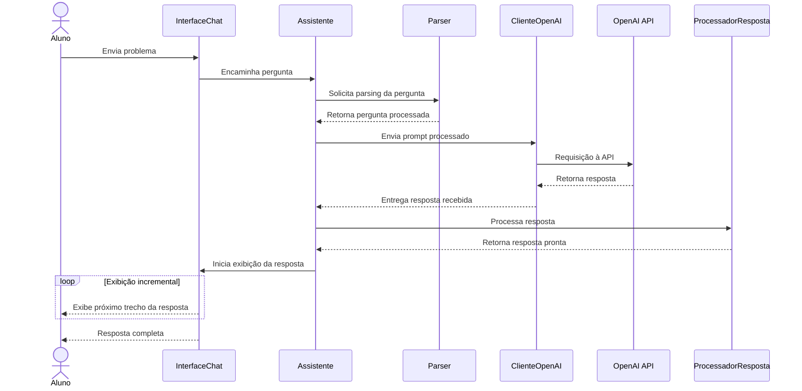
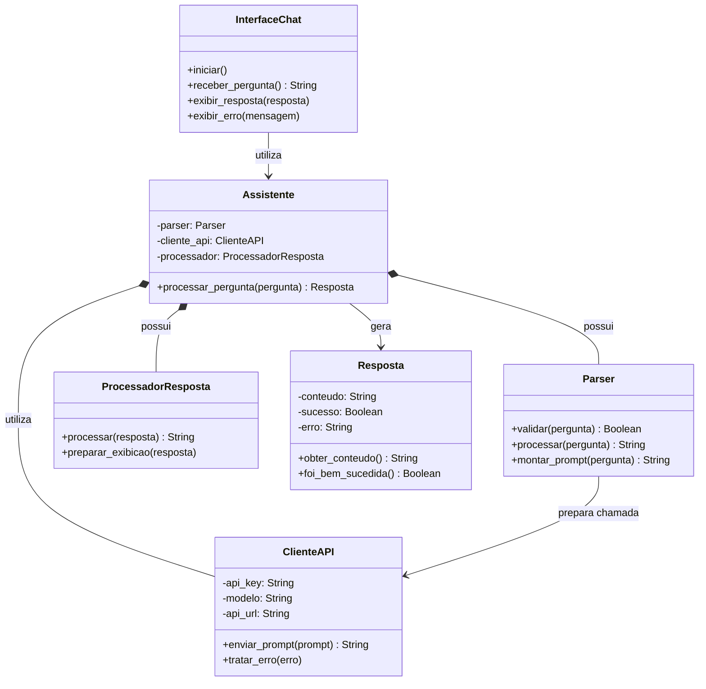

## Diagrama de Sequência — Interação com o Assistente

O diagrama abaixo representa o fluxo temporal de uma interação entre o aluno e o Maieut-IA, desde o envio do problema até a exibição incremental da resposta na interface.

## Diagrama de Classes

O diagrama de classes representa a estrutura estática planejada para o Maieut-IA, destacando as classes responsáveis pela interface, pelo processamento lógico das perguntas e pela integração com a API de inteligência artificial.

