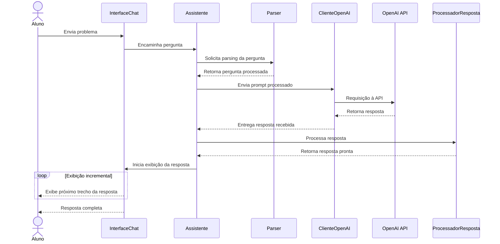

## Diagrama de Sequência — Interação com o Assistente

O diagrama abaixo representa o fluxo temporal de uma interação entre o aluno e o Maieut-IA, desde o envio do problema até a exibição incremental da resposta na interface.

