# EAP — Estrutura Analítica do Projeto (Maieut-IA)

> Decomposição hierárquica do escopo total do projeto, seguindo a **Regra dos 100%**: tudo o que está dentro do Escopo definido no `PROJECT_CHARTER.md` está representado abaixo, nada mais e nada menos. Qualquer trabalho que não esteja ramificado aqui não existe formalmente para o projeto.

## Diagrama (Mermaid)

```mermaid
graph TD
    A[1.0 Maieut-IA] --> B[1.1 Interface com o Usuário]
    A --> C[1.2 Core Lógico & Prompt]
    A --> D[1.3 Integração com LLM]
    A --> E[1.4 Gestão, Testes e Infraestrutura]

    B --> B1[1.1.1 Layout e componentes Streamlit]
    B --> B2[1.1.2 Fluxo de submissão do problema/código]
    B --> B3[1.1.3 Exibição incremental das dicas socráticas]

    C --> C1[1.2.1 Engenharia do System Prompt]
    C --> C2[1.2.2 Parsing/pré-processamento do problema enviado]
    C --> C3[1.2.3 Validação pedagógica anti-vazamento de resposta]

    D --> D1[1.3.1 Cliente HTTP / SDK da OpenAI]
    D --> D2[1.3.2 Gerenciamento de chaves de API]
    D --> D3[1.3.3 Tratamento de rate limit e erros de API]
    D --> D4[1.3.4 Plano de migração de modelo]

    E --> E1[1.4.1 Pipeline de CI/CD]
    E --> E2[1.4.2 Testes automatizados do System Prompt]
    E --> E3[1.4.3 Documentação viva]
    E --> E4[1.4.4 Gestão de Backlog no GitLab]

    E3 --> E31[1.4.3.1 README.md]
    E3 --> E32[1.4.3.2 PROJECT_CHARTER.md]
    E3 --> E33[1.4.3.3 EAP.md]
    E3 --> E34[1.4.3.4 REQUISITOS.md]
    E3 --> E35[1.4.3.5 DIRETRIZES_PROMPT.md]
```

## Decomposição Textual e Pacotes de Trabalho

### 1.0 Maieut-IA
Projeto completo: assistente socrático de maratona de programação.

### 1.1 Interface com o Usuário
Camada de apresentação do assistente, via aplicação Web mínima em Streamlit.

- **1.1.1 Layout e componentes Streamlit** — tela de entrada de problema/código, área de exibição do diálogo, componentes visuais mínimos.
- **1.1.2 Fluxo de submissão do problema/código** — captura do texto colado pelo aluno (enunciado ou código) e envio para o Core Lógico.
- **1.1.3 Exibição incremental das dicas socráticas** — renderização da conversa turno a turno, sem expor a resposta final de uma vez.

### 1.2 Core Lógico & Prompt
Camada de orquestração entre a entrada do aluno e a chamada ao LLM — o coração pedagógico do produto.

- **1.2.1 Engenharia do System Prompt** — redação, versionamento e calibração do prompt que define a postura socrática (detalhado em `docs/DIRETRIZES_PROMPT.md`).
- **1.2.2 Parsing/pré-processamento do problema enviado** — organizar o texto/código recebido antes de repassar ao modelo.
- **1.2.3 Validação pedagógica anti-vazamento de resposta** — bateria de testes que verifica se a resposta do LLM contém código-fonte completo (mitigação do Risco 1 do Charter).

### 1.3 Integração com LLM
Camada de comunicação técnica com a API da OpenAI.

- **1.3.1 Cliente HTTP / SDK da OpenAI** — módulo responsável por montar e enviar as requisições à API.
- **1.3.2 Gerenciamento de chaves de API** — uso de variáveis de ambiente, nunca versionadas em texto aberto (RNF02).
- **1.3.3 Tratamento de rate limit e erros de API** — retries, timeouts e mensagens de fallback ao usuário.
- **1.3.4 Plano de migração de modelo** — preparação para a troca de modelo quando o `gpt-3.5-turbo` for desligado em 23/10/2026 (Risco 5 do Charter).

### 1.4 Gestão, Testes e Infraestrutura
Camada de suporte ao processo de desenvolvimento e à qualidade do produto.

- **1.4.1 Pipeline de CI/CD** — `.gitlab-ci.yml` com lint e execução automática de testes a cada commit.
- **1.4.2 Testes automatizados do System Prompt** — bateria de prompts adversariais (ligada a 1.2.3).
- **1.4.3 Documentação viva** — conjunto dos arquivos de documentação do projeto, mantidos atualizados ao longo do semestre:
  - **1.4.3.1 README.md** — identidade do projeto, equipe e stack tecnológica.
  - **1.4.3.2 PROJECT_CHARTER.md** — Termo de Abertura (justificativa, ideologia, SMART, escopo, riscos).
  - **1.4.3.3 EAP.md** — este documento: decomposição hierárquica e dicionário da EAP.
  - **1.4.3.4 REQUISITOS.md** — Requisitos Funcionais e Não Funcionais.
  - **1.4.3.5 DIRETRIZES_PROMPT.md** — ideologia pedagógica, guia e exemplos de diálogo socrático.
- **1.4.4 Gestão de Backlog no GitLab** — Milestones, Issues, estimativas, labels e mapeamento de dependências.

## Dicionário da EAP
Detalha o critério de aceitação de cada pacote de trabalho-folha — a definição objetiva de "pronto" que será usada na fase de estimativa (PERT) e de acompanhamento do cronograma. Cada pacote também é classificado quanto ao **tipo de escopo** (Cap. 4): **Produto** (funções e recursos que caracterizam o software, visíveis/perceptíveis ao aluno) ou **Projeto** (trabalho gerencial e técnico necessário para construir o produto — implementação interna, testes, infraestrutura, documentação — mas que o usuário final não vê como uma "tela/função").

| Código | Pacote de Trabalho | Tipo de Escopo | Critério de Aceitação |
|---|---|---|---|
| 1.1.1 | Layout e componentes Streamlit | **Produto** | Tela renderiza sem erros, com campo de entrada de texto/código e área de exibição do diálogo visíveis. |
| 1.1.2 | Fluxo de submissão do problema/código | **Produto** | O texto colado pelo aluno é capturado e repassado corretamente ao Core Lógico, sem perda de conteúdo. |
| 1.1.3 | Exibição incremental das dicas socráticas | **Produto** | A resposta do assistente aparece na interface turno a turno (não tudo de uma vez), refletindo o histórico da conversa. |
| 1.2.1 | Engenharia do System Prompt | **Produto** | Prompt versionado no repositório, aprovado nos testes da bateria adversarial (1.4.2) sem vazar código-fonte completo. |
| 1.2.2 | Parsing/pré-processamento do problema enviado | Projeto | O texto recebido é normalizado (sem quebra de formatação) antes de ser enviado à API. |
| 1.2.3 | Validação pedagógica anti-vazamento de resposta | Projeto | Rotina de checagem identifica automaticamente se a resposta do LLM contém código-fonte completo e sinaliza a falha. |
| 1.3.1 | Cliente HTTP / SDK da OpenAI | Projeto | Chamada à API retorna resposta válida em ambiente de teste, com tratamento de erro básico implementado. |
| 1.3.2 | Gerenciamento de chaves de API | Projeto | Nenhuma chave aparece em texto aberto no repositório; chave carregada exclusivamente via variável de ambiente (RNF02). |
| 1.3.3 | Tratamento de rate limit e erros de API | Projeto | Sistema não quebra ao receber erro/rate limit da API; usuário recebe mensagem de fallback compreensível. |
| 1.3.4 | Plano de migração de modelo | Projeto | Documento (ou seção do Charter/EAP) descrevendo o modelo substituto e os passos de troca, pronto antes de 23/10/2026. |
| 1.4.1 | Pipeline de CI/CD | Projeto | `.gitlab-ci.yml` executa lint e testes automaticamente a cada push, bloqueando merge em caso de falha. |
| 1.4.2 | Testes automatizados do System Prompt | Projeto | Bateria de 10-15 prompts adversariais executada e documentada, com taxa de vazamento de resposta registrada. |
| 1.4.3.1 | README.md | Projeto | Arquivo publicado na raiz do repositório, com tabela de equipe, papéis e stack tecnológica preenchidos corretamente. |
| 1.4.3.2 | PROJECT_CHARTER.md | Projeto | Arquivo publicado em `docs/`, contendo todas as seções exigidas (Justificativa, Ideologia, SMART, Escopo, Riscos), sem contradições internas. |
| 1.4.3.3 | EAP.md | Projeto | Arquivo publicado em `docs/`, com diagrama, decomposição textual e Dicionário da EAP cobrindo 100% do escopo do Charter. |
| 1.4.3.4 | REQUISITOS.md | Projeto | Arquivo publicado em `docs/`, com RFs e RNFs numerados e específicos ao Maieut-IA. |
| 1.4.3.5 | DIRETRIZES_PROMPT.md | Projeto | Arquivo publicado em `docs/`, com ideologia pedagógica declarada e ao menos 3 exemplos de diálogo socrático. |
| 1.4.4 | Gestão de Backlog no GitLab | Projeto | 4 Milestones criados, Issues da EAP cadastradas com estimativa, label e responsável, com ao menos uma dependência mapeada. |

**Leitura rápida:** dos 18 pacotes-folha, apenas 4 (1.1.1, 1.1.2, 1.1.3, 1.2.1) são Escopo do Produto — as funções que o aluno de fato percebe e usa. Os outros 14 são Escopo do Projeto: trabalho técnico, de testes, infraestrutura, documentação e gestão que sustenta essas 4 funções, mas que nunca aparece como uma "tela" para quem usa o Maieut-IA. Essa proporção (produto pequeno, projeto grande) é normal e esperada — é o mesmo ponto discutido na Questão 1 do capítulo: a maior parte do esforço real de um projeto de software é invisível ao usuário final.

## Verificação da Regra dos 100%
| Macro-entrega | Cobre o quê do Escopo (Charter) |
|---|---|
| 1.1 Interface com o Usuário | Interface Web mínima em Streamlit |
| 1.2 Core Lógico & Prompt | Dicas socráticas, System Prompt versionado |
| 1.3 Integração com LLM | Integração com a API da OpenAI |
| 1.4 Gestão, Testes e Infraestrutura | Rastreabilidade, riscos técnicos, processo de gestão |

Todos os itens do Escopo "Dentro do MVP" do `PROJECT_CHARTER.md` estão cobertos por algum Pacote de Trabalho acima; nenhum Pacote de Trabalho representa algo fora desse escopo.
