# EAP — Estrutura Analítica do Projeto (Maieut-IA)

> Decomposição hierárquica do escopo total do projeto, seguindo a **Regra dos 100%**: tudo o que está dentro do Escopo definido no `PROJECT_CHARTER.md` está representado abaixo, nada mais e nada menos. Qualquer trabalho que não esteja ramificado aqui não existe formalmente para o projeto.

## Diagrama (Mermaid)

```mermaid
graph TD
    A[1.0 Maieut-IA] --> B[1.1 Interface com o Usuário]
    A --> C[1.2 Core Lógico & Prompt]
    A --> D[1.3 Integração com LLM]
    A --> E[1.4 Gestão, Testes e Infraestrutura]

    B --> B1[1.1.1 Layout e componentes Streamlit]
    B --> B2[1.1.2 Fluxo de submissão do problema/código]
    B --> B3[1.1.3 Exibição incremental das dicas socráticas]

    C --> C1[1.2.1 Engenharia do System Prompt]
    C --> C2[1.2.2 Parsing/pré-processamento do problema enviado]
    C --> C3[1.2.3 Validação pedagógica anti-vazamento de resposta]

    D --> D1[1.3.1 Cliente HTTP / SDK da OpenAI]
    D --> D2[1.3.2 Gerenciamento de chaves de API]
    D --> D3[1.3.3 Tratamento de rate limit e erros de API]
    D --> D4[1.3.4 Plano de migração de modelo]

    E --> E1[1.4.1 Pipeline de CI/CD]
    E --> E2[1.4.2 Testes automatizados do System Prompt]
    E --> E3[1.4.3 Documentação viva]
    E --> E4[1.4.4 Gestão de Backlog no GitLab]
```

## Decomposição Textual e Pacotes de Trabalho

### 1.0 Maieut-IA
Projeto completo: assistente socrático de maratona de programação.

### 1.1 Interface com o Usuário
Camada de apresentação do assistente, via aplicação Web mínima em Streamlit.

- **1.1.1 Layout e componentes Streamlit** — tela de entrada de problema/código, área de exibição do diálogo, componentes visuais mínimos.
- **1.1.2 Fluxo de submissão do problema/código** — captura do texto colado pelo aluno (enunciado ou código) e envio para o Core Lógico.
- **1.1.3 Exibição incremental das dicas socráticas** — renderização da conversa turno a turno, sem expor a resposta final de uma vez.

### 1.2 Core Lógico & Prompt
Camada de orquestração entre a entrada do aluno e a chamada ao LLM — o coração pedagógico do produto.

- **1.2.1 Engenharia do System Prompt** — redação, versionamento e calibração do prompt que define a postura socrática (detalhado em `docs/DIRETRIZES_PROMPT.md`).
- **1.2.2 Parsing/pré-processamento do problema enviado** — organizar o texto/código recebido antes de repassar ao modelo.
- **1.2.3 Validação pedagógica anti-vazamento de resposta** — bateria de testes que verifica se a resposta do LLM contém código-fonte completo (mitigação do Risco 1 do Charter).

### 1.3 Integração com LLM
Camada de comunicação técnica com a API da OpenAI.

- **1.3.1 Cliente HTTP / SDK da OpenAI** — módulo responsável por montar e enviar as requisições à API.
- **1.3.2 Gerenciamento de chaves de API** — uso de variáveis de ambiente, nunca versionadas em texto aberto (RNF02).
- **1.3.3 Tratamento de rate limit e erros de API** — retries, timeouts e mensagens de fallback ao usuário.
- **1.3.4 Plano de migração de modelo** — preparação para a troca de modelo quando o `gpt-3.5-turbo` for desligado em 23/10/2026 (Risco 5 do Charter).

### 1.4 Gestão, Testes e Infraestrutura
Camada de suporte ao processo de desenvolvimento e à qualidade do produto.

- **1.4.1 Pipeline de CI/CD** — `.gitlab-ci.yml` com lint e execução automática de testes a cada commit.
- **1.4.2 Testes automatizados do System Prompt** — bateria de prompts adversariais (ligada a 1.2.3).
- **1.4.3 Documentação viva** — README, Charter, EAP, Requisitos, Diretrizes de Prompt e Wiki, mantidos atualizados ao longo do semestre.
- **1.4.4 Gestão de Backlog no GitLab** — Milestones, Issues, estimativas, labels e mapeamento de dependências.

## Verificação da Regra dos 100%
| Macro-entrega | Cobre o quê do Escopo (Charter) |
|---|---|
| 1.1 Interface com o Usuário | Interface Web mínima em Streamlit |
| 1.2 Core Lógico & Prompt | Dicas socráticas, System Prompt versionado |
| 1.3 Integração com LLM | Integração com a API da OpenAI |
| 1.4 Gestão, Testes e Infraestrutura | Rastreabilidade, riscos técnicos, processo de gestão |

Todos os itens do Escopo "Dentro do MVP" do `PROJECT_CHARTER.md` estão cobertos por algum Pacote de Trabalho acima; nenhum Pacote de Trabalho representa algo fora desse escopo.